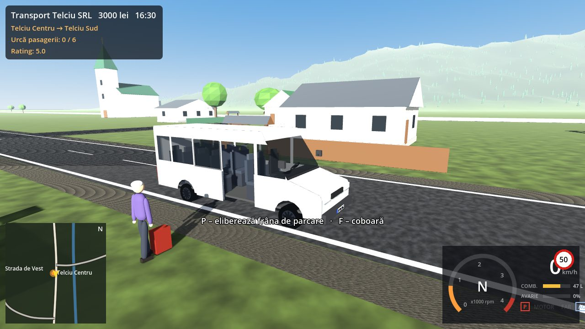

# Drumul Lung — simulator de transport (prototip 0.1)

Joc 3D de condus și transport de persoane și marfă, făcut în **Godot 4.3** (gratuit, open-source). Proiectul pornește din zona comunei **Telciu** (Bistrița-Năsăud) și va fi extins pe etape spre Colibița, Brașov și apoi spre Ungaria, Austria, Germania și Italia.



## Cum îl joci

### Pe telefon (Android)
1. Descarcă pe telefon fișierul [`releases/DrumulLung-0.1.0-android.apk`](releases/DrumulLung-0.1.0-android.apk).
2. Deschide-l. Android te întreabă dacă permiți instalarea din această sursă: alege **Permite**.
3. Pornește **Drumul Lung**. Jocul se joacă orizontal, cu butoanele de pe ecran.

APK-ul e o versiune de test, semnată cu o cheie de dezvoltare. De aceea nu e în Magazin Play și Android afișează un avertisment la instalare. Necesită Android 5.0 sau mai nou (API 21), pe procesor ARM (aproape toate telefoanele).

### Pe calculator (Windows)
Dezarhivează [`releases/DrumulLung-0.1.0-windows.zip`](releases/DrumulLung-0.1.0-windows.zip) și pornește `DrumulLung.exe`.

### Din cod (orice sistem)
1. Instalează [Godot 4.3](https://godotengine.org/download/archive/4.3-stable/) (versiunea standard, nu .NET).
2. În Godot: **Import** → alege fișierul `drumul-lung/project.godot` → **Run** (F5).

## Controale

| Acțiune | Tastatură | Controller | Ecran tactil |
|---|---|---|---|
| Accelerație / frână (pe jos: înainte/înapoi) | W / S | RT / LT | GAZ / FRÂNĂ |
| Virare (pe jos: lateral) | A / D | stick stâng | ◀ ▶ |
| Frână de mână · frână de parcare | Spațiu · P | X | MÂNĂ |
| Ambreiaj (pe jos: alergare) | Shift | B | — |
| Treaptă sus / jos (automat: D–N–R) | Q / Z | RB / LB | Treaptă+ / Treaptă− |
| Pornire / oprire motor | E | cruce dreapta | Motor |
| Urcă / coboară din vehicul | F | Y | F urcă |
| Ușa pasagerilor | O | cruce sus | Uși |
| Cuplare / decuplare remorcă | T | cruce jos | Remorcă |
| Acțiune (alimentare, reparație) | X | A | Acțiune |
| Faruri · claxon · cameră | L · H · C | cruce stânga · stick stâng apăsat · stick drept apăsat | Faruri · Claxon · Cameră |
| Repune vehiculul pe drum | R | — | — |
| Hartă · contracte · meniu | M · J · Esc | Back · — · Start | ☰ |

Ca să te uiți în jur, ține apăsat click dreapta și trage cu mouse-ul, trage cu degetul pe ecran sau folosește stick-ul drept.

## Ce conține prima versiune

| Cerință | Stare | Detalii |
|---|---|---|
| Zonă în care conduci | ✅ funcțională | vale de ~3 × 4 km, teren cu dealuri și pădure, limite de hartă |
| Hartă inspirată de Telciu | ✅ **schiță aproximativă** | DN17C prin centru (spre Salva/Năsăud la sud, spre Romuli la nord), râul Sălăuța, biserică, primărie, școală, cămin cultural, magazin, benzinărie, ~220 de case cu garduri, porți și șuri. **Nu e harta reală**: OpenStreetMap nu a fost accesibil la creare. Pentru străzile reale vezi `tools/osm_import.py`. |
| Microbuz tip Sprinter cu interior | ✅ | 1+14 locuri, ușă glisantă și ușă de șofer care se deschid, bord cu ace, volan care se rotește, spațiu pentru bagaje, faruri, stopuri și lămpi de marșarier. Model original inspirat de categorie, nu modelul licențiat Mercedes-Benz. |
| BMW E46 controlabil | ✅ | „Sedan R6 3.0 (tip E46)” și „Sedan 2.0 diesel (tip E46)”, cu date tehnice reale de categorie. Model original, nu cel licențiat BMW. |
| Personaj care urcă și coboară | ✅ | mers, alergare, urcare pe ușa șoferului, coborâre doar sub 4 km/h |
| Remorcă cuplabilă | ✅ | remorcă de bagaje (nefrânată, 600 kg) și platformă auto (frânată, 2.700 kg). Cuplare cu articulație fizică, reguli de compatibilitate după masa remorcabilă a vehiculului, frânare transmisă doar la remorca frânată. |
| Drumuri și trafic de bază | ✅ | marcaje românești, poduri, 10 mașini AI pe benzi, care păstrează distanța, încetinesc la intersecții și respectă limita |
| Sistem simplu de curse | ✅ | curse cu pasageri între 6 stații (bilet încasat la urcare, bagaje în portbagaj, rating 1–5) și transport de bagaje cu remorca |
| Interfață funcțională | ✅ | bord, minimapă cu GPS, hartă completă, contracte, garaj, magazin, firmă, setări, ajutor, controale tactile |

Mai sunt incluse:
- **Vehiculul:** motor cu curbă de cuplu, ambreiaj (pedală sau asistat, motorul se poate opri), cutie manuală sau automată, frână de motor, consum de combustibil, avarii la impact.
- **Locuri de pe hartă:** benzinărie, unde plătești combustibilul, service la depou și radar cu amendă.
- **Ambianța:** ciclu zi-noapte cu ferestrele caselor luminate, sunet de motor sintetizat (V8, 6 sau 4 cilindri, diesel).
- **Economie și salvare:** cumpărare și vânzare de vehicule, salvare automată.

### Verificat cu teste automate
`tests/run_tests.gd` conduce vehiculele reale prin motorul fizic. Toate cele 22 de verificări trec:

| Test | Rezultat | Valoare reală |
|---|---|---|
| 0–100 km/h, tip 330i | 6,7 s | ≈ 6,5 s |
| Frânare 100–0 km/h | 41 m | ≈ 38–42 m |
| Microbuz 0–80 km/h | 10,6 s | ≈ 10–12 s |
| Consum la 90 km/h constant | 7,5 L/100 km | ≈ 6–8 L/100 km |
| Viraj strâns la 50 km/h | derapează și încetinește, nu se răstoarnă | — |
| Cutie manuală | motorul se oprește dacă eliberezi brusc ambreiajul | — |

Testele mai verifică urcarea și coborârea, cuplarea remorcii și refuzul unei remorci prea grele, cursa cu pasageri de la cap la coadă, traficul, radarul și salvarea.

```
godot --headless --path drumul-lung -s res://tests/run_tests.gd
```

### Ce e simplificat (spus direct)
- **Modelele 3D** ale vehiculelor, caselor și oamenilor sunt originale, low-poly și generate din cod. Nu am folosit modele comerciale. Fotorealismul cere modele licențiate (etapa 5).
- **Traficul** e cinematic: mașinile AI nu au fizică proprie și nu se avariază. Nu există încă semafoare sau prioritate reală la intersecții. Uneori o mașină „sare” câțiva metri când intră pe alt drum.
- **Oglinzile** sunt doar decor, fără imagine reflectată.
- **Pasagerii** merg pe un traseu drept până la ușă, fără animații de urcat scări.
- **Sunetul** e sintetizat în timp real, nu înregistrat de la motoare reale.
- **Vremea** (ploaie, ceață, ninsoare) nu există încă. Lumina se schimbă doar cu ora.
- **Amenzile** au valori aproximative.
- **iOS:** proiectul se poate exporta, dar doar de pe un Mac cu Xcode și cont Apple Developer. Nu am putut construi aici.
- **Testarea:** APK-ul și versiunea Windows au fost construite și semnate, dar nu au fost încercate pe un telefon sau un PC real.

## Structura proiectului

```
drumul-lung/
├── project.godot            setări (renderer compatibil mobil, 120 Hz fizică)
├── export_presets.cfg       Android, Windows, Linux
├── scenes/main.tscn         scena de pornire
├── data/
│   ├── maps/telciu.json     harta (drumuri, râu, stații, clădiri importante, indicatoare)
│   └── vehicles/*.json      vehicule și remorci (motor, cutie, mase, remorcare, preț)
├── scripts/
│   ├── main.gd              leagă toate sistemele
│   ├── core/                tastatură/controller, stare și salvare, zi–noapte
│   ├── world/               rețea de drumuri și GPS, generatorul lumii, unelte de geometrie
│   ├── vehicles/            vehicul, remorcă, generator de modele
│   ├── player/              personaj, camere
│   ├── traffic/             trafic AI
│   ├── jobs/                contracte și pasageri
│   ├── audio/               sunet de motor
│   └── ui/                  HUD, bord, hartă, meniu, controale tactile
├── tools/osm_import.py      import OpenStreetMap → hartă de joc
├── tests/                   teste automate și capturi de ecran
└── docs/ARHITECTURA.md      arhitectura și planul pe etape
```

Arhitectura, formatul datelor și etapele următoare sunt în [docs/ARHITECTURA.md](docs/ARHITECTURA.md).
